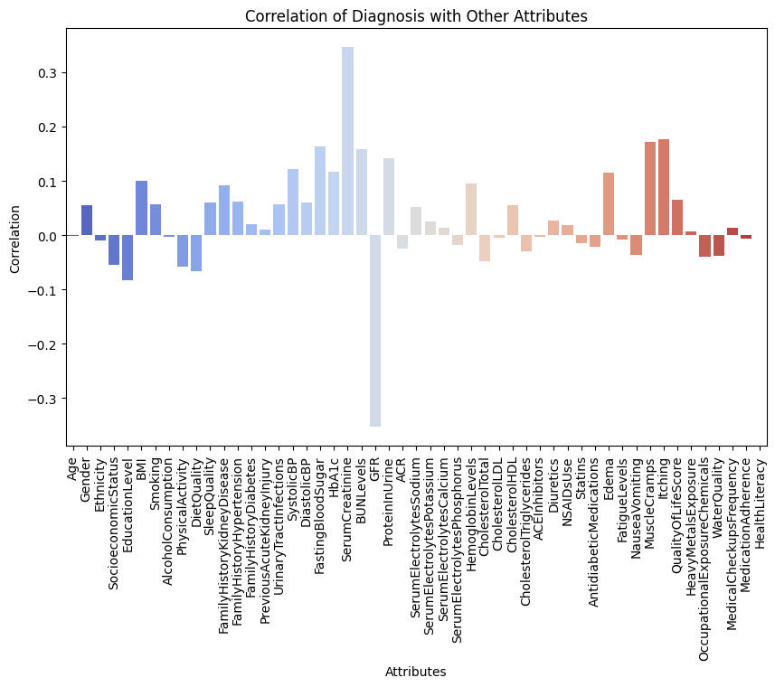
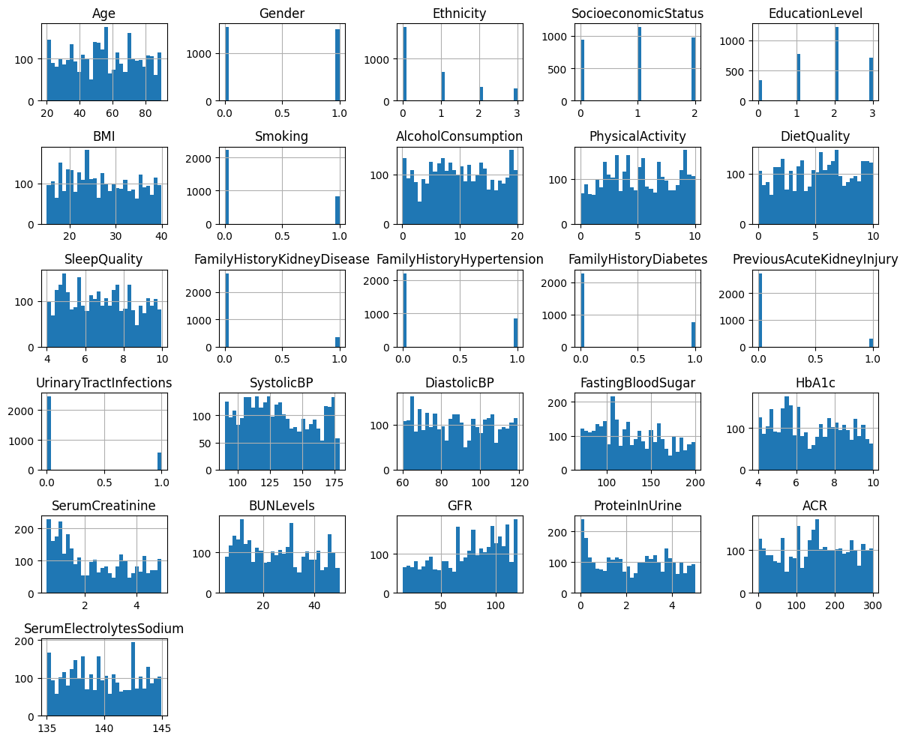
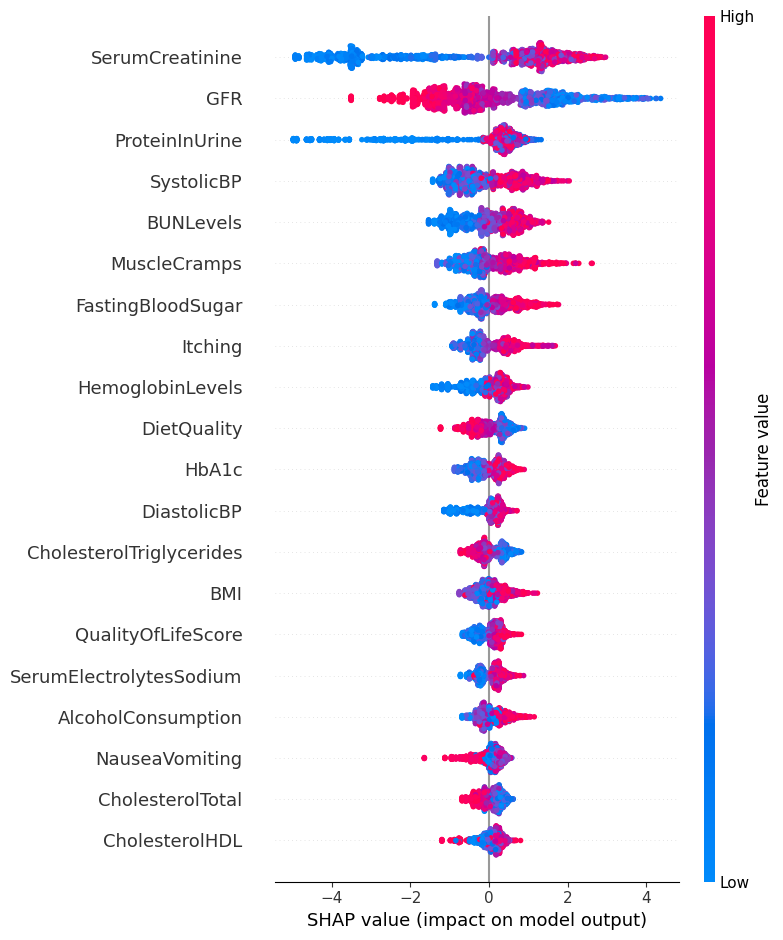
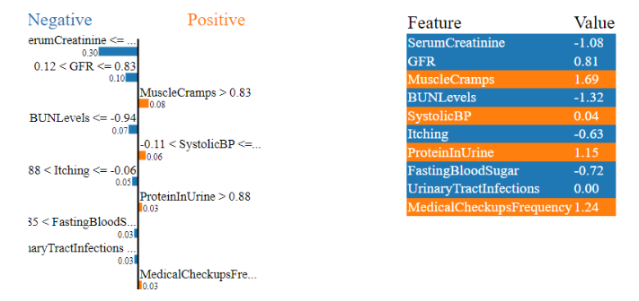

# 🩺 Kidney Disease Machine Learning & XAI

Machine Learning and Explainable AI for Kidney Disease Analysis — Springer Published Research

<div align="center">


[](https://colab.research.google.com/github/sadiashatabdi/kidney-disease-machine-learning-xai/blob/main/Balanced_Kidney_disease.ipynb)
[](https://doi.org/10.1007/978-3-032-33698-9_31)

</div>

---

## 📌 Overview

Chronic Kidney Disease (CKD) is a major global health burden, and late diagnosis can lead to severe complications. This project builds an interpretable machine learning pipeline that predicts CKD using patient clinical, lifestyle, and laboratory information, while also explaining why the model makes each decision.

This repository contains the implementation behind our paper, published in Innovations in Data Analytics (ICIDA 2025, Springer LNNS vol. 2099), and presented at the International Conference on Innovations in Data Analytics.

📄 Paper: https://doi.org/10.1007/978-3-032-33698-9_31

### Research Questions

- RQ1: How accurately can machine learning algorithms predict CKD from clinical and biochemical parameters?
- RQ2: How can explainable AI (SHAP, LIME) identify and interpret the most influential features in CKD diagnosis?

---

## ✨ Key Highlights

| Area | Highlight |
|---|---|
| 🏆 Best model | Random Forest with 99.89% accuracy, 100% precision, 99.79% recall, 99.89% F1 |
| 🥈 Runner-up | XGBoost with 98.80% accuracy, 100% precision, 97.67% recall, 98.82% F1 |
| 🔬 Statistical testing | 9 hypotheses tested using t-test, Pearson correlation, ANOVA, and Chi-square |
| 🧠 Explainability | Global SHAP analysis and local LIME explanations |
| 🧩 Unsupervised analysis | K-Means, DBSCAN, Gaussian Mixture, PCA, and t-SNE |

---

## 📊 Dataset

- Source: Chronic Kidney Disease Dataset Analysis, Kaggle (Rabie El Kharoua)
- Original size: 1,659 patient records and 54 attributes
- Content: demographics, lifestyle, medical history, laboratory measurements, symptoms, and environmental exposure
- Target: Diagnosis (CKD vs. non-CKD)
- Preprocessing: removal of non-informative columns such as PatientID and DoctorInCharge, StandardScaler for numerical features, and a class-balanced version of the data
- Data file: not included in this repository; download it from the Kaggle link and place it where the notebook expects it


---

## 🔬 Methodology

```text
Dataset → Preprocessing → EDA → Clustering & Visualization → Feature Analysis → Model Training → Evaluation → XAI
```

1. Preprocessing: remove irrelevant columns, check missing values and outliers, scale features
2. EDA: inspect distributions, boxplots, and feature correlation with the target label
3. Unsupervised learning: K-Means, DBSCAN, and Gaussian Mixture with PCA and t-SNE visualization
4. Hypothesis testing: evaluate 9 key hypotheses on biomarkers and lifestyle factors
5. Modeling: Logistic Regression, Decision Tree, Random Forest, MLP Neural Network, XGBoost, KNN, and SVM with RandomizedSearchCV tuning
6. Explainability: SHAP summary plots and LIME patient-specific explanations

---

## 📈 Results

### Model Performance

| Model | Accuracy (%) | Precision (%) | Recall (%) | F1-Score (%) |
|---|---:|---:|---:|---:|
| **Random Forest** | **99.89** | **100.00** | **99.79** | **99.89** |
| XGBoost | 98.80 | 100.00 | 97.67 | 98.82 |

<p align="center">
  
  
</p>

<p align="center">
  
</p>

### Statistical Findings

| Feature | Test | Result |
|---|---|---|
| Serum Creatinine | t-test | Significant (t = 20.35, p < 0.05) |
| GFR | t-test / Pearson | Significant (t = −20.86, p < 0.05) |
| Systolic BP | ANOVA / t-test | Significant (F = 45.36) |
| Smoking | Chi-square | Significant (χ² = 9.58, p = 0.002) |
| Muscle Cramps | Chi-square | Significant (χ² = 93.01) |
| Family History of Kidney Disease | Chi-square | Significant (χ² = 25.19) |
| Hemoglobin | Pearson | Significant (r ≈ 0.095, weak) |
| Protein in Urine | ANOVA | Significant (F = 62.75) |
| Alcohol Consumption | t-test | Not significant (p = 0.879) |

<p align="center">
  
</p>

### 🧠 Explainable AI

SHAP ranks Serum Creatinine and GFR as the most influential features, followed by Muscle Cramps, Fasting Blood Sugar, Protein in Urine, and BUN Levels. BMI, serum sodium, and medication adherence have comparatively minor impact.

<p align="center">
  
</p>

LIME provides patient-level explanations, showing which features push an individual prediction toward or away from CKD.

<p align="center">
  
</p>

---

## 🗂️ Repository Structure

```text
kidney-disease-machine-learning-xai/
├── README.md
├── requirements.txt
├── .gitignore
├── notebooks/
│   └── Balanced_Kidney_disease.ipynb
└── assets/
    ├── eda-visualizations.png
    ├── model-comparison.png
    ├── confusion-matrix.png
    ├── roc-curves.png
    ├── shap-summary.png
    └── lime-explanation.png
```

---

## 🚀 Getting Started

### Option 1: Google Colab (recommended)

1. Click the Open in Colab badge above, or open `notebooks/Balanced_Kidney_disease.ipynb` in Google Colab.
2. Upload `Balanced_Chronic_Kidney_Disease_data.csv` to the Colab session, or mount Google Drive and update the path in the notebook.
3. Run all cells.

### Option 2: Run locally

```bash
git clone https://github.com/sadiashatabdi/kidney-disease-machine-learning-xai.git
cd kidney-disease-machine-learning-xai

python -m venv venv
source venv/bin/activate        # Windows: venv\Scripts\activate

pip install -r requirements.txt
jupyter notebook notebooks/Balanced_Kidney_disease.ipynb
```

---

## ⚠️ Limitations & Future Work

- The dataset is public and largely synthetic-style; it is not clinically validated and should not be used for real patient diagnosis.
- SMOTE is applied only to the training split after the train/test split, so the test set remains untouched. However, near-perfect performance suggests the dataset is highly separable.
- Future work includes deeper hyperparameter tuning, ensemble methods, cross-validation on external cohorts, and richer clinical features.

---

## 📄 Citation

If you use this work, please cite the paper below:

```bibtex
@inproceedings{shatabdi2026kidney,
  title     = {Leveraging Machine Learning and Explainable AI for the Systematic Study of Kidney Disease},
  author    = {Shatabdi, Sadia and Mehajabin, Mariya and Mariam, Samia Jahan and Gani, Raiyan and Shams, Karib and Nobi, Md Mahmudun},
  booktitle = {Innovations in Data Analytics (ICIDA 2025)},
  series    = {Lecture Notes in Networks and Systems},
  volume    = {2099},
  pages     = {434--444},
  publisher = {Springer, Cham},
  year      = {2026},
  doi       = {10.1007/978-3-032-33698-9_31}
}
```

> Paper: https://doi.org/10.1007/978-3-032-33698-9_31

---

## 👥 Authors

**Sadia Shatabdi** (first author, technical implementation, presenter) · Mariya Mehajabin · Samia Jahan Mariam · Raiyan Gani (corresponding author) · Karib Shams · Md Mahmudun Nobi

Department of Computer Science and Engineering, East West University, Dhaka, Bangladesh.

📧 Contact: sadiashatabdi00@gmail.com

---

<div align="center">
  ⭐ If you find this project useful, please consider giving it a star!
</div>
